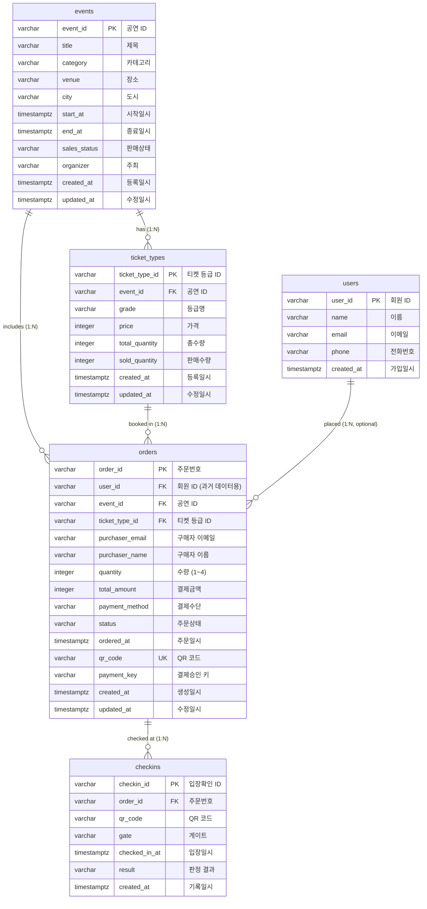

# 온티켓 데이터 설계서 (ERD)

- 버전: 1.1
- 상태: 확정
- 작성일: 2026-11-07
- 근거: `docs/PRD.md` (버전 1.1, 확정), `docs/화면기획서.md` (버전 1.0, 확정), `docs/API-Spec.md` (버전 1.0, 확정), `data/events.csv`, `data/ticket_types.csv`, `data/users.csv`, `data/orders.csv`, `data/checkins.csv`

| 버전 | 날짜 | 바꾼 것 | 결정자 |
|---|---|---|---|
| 0.1 | 2026-11-07 | 초안 작성: 5개 테이블 설계, CHECK 제약(초과 판매 방지), 주문자 이메일 필수화, 상태값 정의 | DBA |
| 1.0 | 2026-11-07 | 사람의 검토 완료(화면 표시 항목 대조, 제약조건 및 상태값 이상 없음 확인)에 따른 설계 확정 | 사용자(검토), DBA |
| 1.1 | 2026-11-07 | API 명세(docs/API-Spec.md v1.0) 확정 반영: 6절 대조표에 S06(운영 비밀번호 확인) 추가, 결제 및 조회 흐름 문장 정비 (스키마·DB 불변) | 아키텍트 |

---

## 1. 엔티티 및 테이블 목록

온티켓의 데이터 모델은 도메인의 5개 핵심 엔티티를 바탕으로 구성된다.

| 테이블명 | 논리명 | 엔티티 설명 | 데이터 건수 (시드 기준) |
|---|---|---|---|
| `events` | 공연 | (주)승승장구가 주최하는 공연 정보 및 판매 상태 | 12건 |
| `ticket_types` | 티켓 등급 | 공연에 속한 등급별 가격, 총수량 및 판매수량 | 26건 |
| `users` | 회원 | 과거 운영 데이터의 회원 명단 (1차 버전은 비회원 예매이므로 참조용) | 50명 |
| `orders` | 주문 | 비회원 고객의 티켓 예매·결제·상태 및 QR 코드 정보 | 300건 |
| `checkins` | 입장 기록 | 공연장 게이트 현장에서 QR 코드를 스캔한 입장 기록 | 15건 |

---

## 2. 개체-관계도 (ERD)

---

## 3. 테이블별 상세 설계

### 3.1 `events` (공연)

(주)승승장구의 공연 정보를 관리하는 테이블이다.

| 컬럼명 | 논리명 | 타입 | Null | 기본값 | 제약 | 비고 |
|---|---|---|---|---|---|---|
| `event_id` | 공연 ID | VARCHAR(30) | N | - | PK | 예: 'EV001' |
| `title` | 제목 | VARCHAR(200) | N | - | - | CSV '제목' |
| `category` | 카테고리 | VARCHAR(50) | N | - | - | 콘서트, 뮤지컬, 세미나 등 |
| `venue` | 장소 | VARCHAR(200) | N | - | - | CSV '장소' |
| `city` | 도시 | VARCHAR(50) | N | - | - | CSV '도시' (서울 등) |
| `start_at` | 시작일시 | TIMESTAMPTZ | N | - | - | CSV '시작일시' |
| `end_at` | 종료일시 | TIMESTAMPTZ | N | - | - | CSV '종료일시' |
| `sales_status` | 판매상태 | VARCHAR(20) | N | '판매중' | CHECK (`sales_status` IN ('판매중', '매진', '판매종료')) | CSV '판매상태' (한국어 유지) |
| `organizer` | 주최 | VARCHAR(100) | N | '(주)승승장구' | - | CSV '주최' |
| `created_at` | 등록일시 | TIMESTAMPTZ | N | NOW() | - | 시스템 관리 컬럼 |
| `updated_at` | 수정일시 | TIMESTAMPTZ | N | NOW() | - | 시스템 관리 컬럼 |

---

### 3.2 `ticket_types` (티켓 등급)

공연별 좌석 등급, 가격, 총수량 및 판매수량을 관리하는 테이블이다.

| 컬럼명 | 논리명 | 타입 | Null | 기본값 | 제약 | 비고 |
|---|---|---|---|---|---|---|
| `ticket_type_id` | 티켓 등급 ID | VARCHAR(30) | N | - | PK | 예: 'TT001' |
| `event_id` | 공연 ID | VARCHAR(30) | N | - | FK (`events.event_id`) | 어느 공연의 등급인지 참조 |
| `grade` | 등급명 | VARCHAR(50) | N | - | - | VIP, R석, S석, 일반 등 |
| `price` | 가격 | INTEGER | N | 0 | CHECK (`price` >= 0) | 원 단위 정수 |
| `total_quantity` | 총수량 | INTEGER | N | 0 | CHECK (`total_quantity` >= 0) | 발행 총 좌석 수 |
| `sold_quantity` | 판매수량 | INTEGER | N | 0 | CHECK (`sold_quantity` >= 0) | 결제 완료된 수량 합계 |
| `created_at` | 등록일시 | TIMESTAMPTZ | N | NOW() | - | 시스템 관리 컬럼 |
| `updated_at` | 수정일시 | TIMESTAMPTZ | N | NOW() | - | 시스템 관리 컬럼 |

- **테이블 레벨 제약조건**:
  - `CHECK (sold_quantity <= total_quantity)`: 판매수량이 총수량을 초과할 수 없음 (**초과 판매 방지 DB 강제**)
- **파생값 제외 규칙**:
  - `잔여수량`(`remaining_quantity`)은 `total_quantity - sold_quantity`로 계산되는 값이므로 별도 컬럼으로 저장하지 않는다. API 서버가 계산하여 화면에 응답한다.

---

### 3.3 `users` (회원 — 과거 데이터 보관용)

운영팀이 제공한 과거 고객 명단이다. 1차 서비스는 비회원 예매이므로 읽기/참조용으로 유지한다.

| 컬럼명 | 논리명 | 타입 | Null | 기본값 | 제약 | 비고 |
|---|---|---|---|---|---|---|
| `user_id` | 회원 ID | VARCHAR(30) | N | - | PK | 예: 'U0001' |
| `name` | 이름 | VARCHAR(100) | N | - | - | CSV '이름' |
| `email` | 이메일 | VARCHAR(255) | N | - | - | CSV '이메일' |
| `phone` | 전화번호 | VARCHAR(50) | N | - | - | CSV '전화번호' |
| `created_at` | 가입일시 | TIMESTAMPTZ | N | NOW() | - | CSV '가입일시' |

---

### 3.4 `orders` (주문)

티켓 예매, 결제 진행 및 QR 코드 발급 정보를 기록하는 핵심 테이블이다.

| 컬럼명 | 논리명 | 타입 | Null | 기본값 | 제약 | 비고 |
|---|---|---|---|---|---|---|
| `order_id` | 주문번호 | VARCHAR(30) | N | - | PK | `ORD-YYYYMMDD-####` 형식 |
| `user_id` | 회원 ID | VARCHAR(30) | Y | NULL | FK (`users.user_id`) | 비회원 주문은 NULL (과거 300건 매핑) |
| `event_id` | 공연 ID | VARCHAR(30) | N | - | FK (`events.event_id`) | 예매한 공연 |
| `ticket_type_id` | 티켓 등급 ID | VARCHAR(30) | N | - | FK (`ticket_types.ticket_type_id`) | 예매한 티켓 등급 |
| `purchaser_email` | 구매자 이메일 | VARCHAR(255) | N | - | - | **로그인 없는 1차 버전의 주문 식별 키** |
| `purchaser_name` | 구매자 이름 | VARCHAR(100) | Y | NULL | - | 구매자 성명 |
| `quantity` | 수량 | INTEGER | N | 1 | CHECK (`quantity` >= 1 AND `quantity` <= 4) | 1회 예매 시 1~4매 (R1, AC2) |
| `total_amount` | 결제금액 | INTEGER | N | 0 | CHECK (`total_amount` >= 0) | **주문 시점의 확정 결제금액 보존** |
| `payment_method` | 결제수단 | VARCHAR(50) | Y | NULL | - | 카드, 카카오페이, 토스페이 등 |
| `status` | 주문 상태 | VARCHAR(20) | N | '결제대기' | CHECK (`status` IN ('결제대기', '결제완료', '입장완료', '취소', '환불', '실패')) | 한국어 상태값 유지 (결제대기·실패 포함) |
| `ordered_at` | 주문일시 | TIMESTAMPTZ | N | NOW() | - | CSV '주문일시' |
| `qr_code` | QR 코드 | VARCHAR(50) | Y | NULL | UNIQUE | `OT-####-XXXX` 형식, 결제완료 시 발급 |
| `payment_key` | 결제승인 키 | VARCHAR(100) | Y | NULL | - | 결제대행사 승인 식별자 |
| `created_at` | 생성일시 | TIMESTAMPTZ | N | NOW() | - | 시스템 관리 컬럼 |
| `updated_at` | 수정일시 | TIMESTAMPTZ | N | NOW() | - | 시스템 관리 컬럼 |

- **파생값 제외 규칙**:
  - CSV의 '등급' 열은 `ticket_types.grade`에서 조회할 수 있으므로 중복 저장하지 않는다.
- **제약 및 업무 규칙**:
  - `qr_code`는 중복 발급을 방지하기 위해 `UNIQUE` 제약을 건다 (AC15).
  - 결제가 완료되지 않은 주문(`결제대기`, `실패`, `취소`)은 `qr_code`가 NULL이어야 한다 (R22, AC16).
  - `purchaser_email`은 필수(NOT NULL)이며 티켓 조회(S05) 시 `order_id`와 함께 검증된다 (R21, AC36).

---

### 3.5 `checkins` (입장 확인 기록)

공연장 현장 게이트에서 QR 코드를 인식해 입장시킨 이력을 남기는 테이블이다.

| 컬럼명 | 논리명 | 타입 | Null | 기본값 | 제약 | 비고 |
|---|---|---|---|---|---|---|
| `checkin_id` | 입장확인 ID | VARCHAR(30) | N | - | PK | 예: 'CHK0001' |
| `order_id` | 주문번호 | VARCHAR(30) | N | - | FK (`orders.order_id`) | 입장 처리된 주문 |
| `qr_code` | QR 코드 | VARCHAR(50) | N | - | - | 스캔된 QR 코드 문자열 |
| `gate` | 게이트 | VARCHAR(50) | N | - | - | A게이트, B게이트, C게이트 등 |
| `checked_in_at` | 입장일시 | TIMESTAMPTZ | N | NOW() | - | 스캔된 시각 |
| `result` | 판정 결과 | VARCHAR(20) | N | '정상' | CHECK (`result` IN ('정상')) | 현장 입장 판정 결과 |
| `created_at` | 기록일시 | TIMESTAMPTZ | N | NOW() | - | 시스템 관리 컬럼 |

---

## 4. DB 제약조건 (Constraints) 목록

| 대상 테이블 | 제약조건 이름 | 제약 유형 | 조건식 / 정의 | 목적 |
|---|---|---|---|---|
| `ticket_types` | `chk_ticket_types_sold_limit` | CHECK | `sold_quantity <= total_quantity` | **초과 판매 원천 차단** (코드가 뚫려도 DB가 거부) |
| `ticket_types` | `chk_ticket_types_price` | CHECK | `price >= 0` | 음수 가격 방지 |
| `ticket_types` | `chk_ticket_types_quantity` | CHECK | `total_quantity >= 0 AND sold_quantity >= 0` | 음수 수량 방지 |
| `orders` | `chk_orders_quantity_range` | CHECK | `quantity >= 1 AND quantity <= 4` | 1인당 구매 제한 1~4매 강제 (R1) |
| `orders` | `chk_orders_total_amount` | CHECK | `total_amount >= 0` | 음수 결제금액 방지 |
| `orders` | `chk_orders_status` | CHECK | `status IN ('결제대기', '결제완료', '입장완료', '취소', '환불', '실패')` | 허용되지 않은 주문 상태 차단 |
| `orders` | `uq_orders_qr_code` | UNIQUE | `UNIQUE (qr_code)` | **QR 코드 중복 발급 방지** (한 장으로 2명 입장 차단) |
| `events` | `chk_events_sales_status` | CHECK | `sales_status IN ('판매중', '매진', '판매종료')` | 유효한 판매상태 강제 |
| `ticket_types` | `fk_ticket_types_event_id` | FOREIGN KEY | `event_id REFERENCES events(event_id)` | 존재하지 않는 공연 등급 생성 방지 |
| `orders` | `fk_orders_event_id` | FOREIGN KEY | `event_id REFERENCES events(event_id)` | 존재하지 않는 공연 주문 방지 |
| `orders` | `fk_orders_ticket_type_id` | FOREIGN KEY | `ticket_type_id REFERENCES ticket_types(ticket_type_id)` | 존재하지 않는 등급 주문 방지 |
| `orders` | `fk_orders_user_id` | FOREIGN KEY | `user_id REFERENCES users(user_id)` | 과거 회원 데이터 무결성 |
| `checkins` | `fk_checkins_order_id` | FOREIGN KEY | `order_id REFERENCES orders(order_id)` | 존재하지 않는 주문의 입장 기록 방지 |

---

## 5. 상태값 목록

모든 상태값은 PRD 및 CSV 원본의 한국어 단어를 그대로 사용한다.

### 5.1 공연 판매상태 (`events.sales_status`)
- `판매중`: 정상적으로 티켓 예매가 가능한 상태 (S01, S02 표시)
- `매진`: 기획사/운영팀이 공연을 매진 처리한 상태 (잔여수량이 있어도 예매 불가, AC45)
- `판매종료`: 예매 기간이 마감되었거나 종료된 상태 (목록 노출 제외, 직접 접근 시 S02-T10)

### 5.2 주문 상태 (`orders.status`)
- `결제대기`: 고객이 예매 정보를 입력하고 주문을 생성한 상태 (`POST /orders`, 재고 선점 상태, QR 미발급)
- `결제완료`: 서버가 결제대행사의 결제를 성공적으로 승인한 상태 (`POST /orders/:order_id/payment`, `qr_code` 발급, 판매수량 확정 반영)
- `입장완료`: 공연장 현장 게이트에서 QR 코드를 인증하고 입장한 상태 (`POST /admin/checkins`)
- `취소`: 고객 또는 운영자가 주문을 취소한 상태
- `환불`: 결제 금액이 환불된 상태
- `실패`: 결제 과정에서 승인 거절 또는 오류가 발생한 상태 (재고 복구 대상, QR 미발급)

### 5.3 입장 판정 결과 (`checkins.result`)
- `정상`: 유효한 티켓으로 인증되어 입장이 허용된 상태

---

## 6. 화면기획서와의 항목 대조표

| 화면 ID | 화면 명칭 | 화면 표시 / 입력 항목 | ERD 컬럼 또는 계산값 출처 |
|---|---|---|---|
| S01 | 공연 목록 | 포스터, 제목, 카테고리, 시작일시, 장소, 도시 | `events.title`, `events.category`, `events.start_at`, `events.venue`, `events.city` |
| S01 | 공연 목록 | 매진 표시 판정 | `events.sales_status = '매진'` 또는 모든 등급의 `total_quantity - sold_quantity = 0` |
| S02 | 공연 상세·예매 | 공연 정보 (제목, 카테고리, 일시, 장소) | `events.*` |
| S02 | 공연 상세·예매 | 등급 목록 (등급명, 가격) | `ticket_types.grade`, `ticket_types.price` |
| S02 | 공연 상세·예매 | 남은 수량 | `ticket_types.total_quantity - ticket_types.sold_quantity` (계산값) |
| S02 | 공연 상세·예매 | 수량 선택 (1~4) | `orders.quantity` (CHECK 제약 1~4) |
| S02 | 공연 상세·예매 | 이메일 입력 | `orders.purchaser_email` (NOT NULL 필수) |
| S02 | 공연 상세·예매 | 결제 금액 | `ticket_types.price * orders.quantity` -> `orders.total_amount` |
| S03 | 결제 완료 | 주문번호, 공연명, 등급, 수량, 결제금액 | `orders.order_id`, `events.title`, `ticket_types.grade`, `orders.quantity`, `orders.total_amount` |
| S03 | 결제 완료 | QR 티켓 표시 | `orders.qr_code` |
| S04 | 결제 실패 | 실패 안내 및 재시도 | `orders.status = '실패'` |
| S05 | 티켓 조회 | 주문번호 및 이메일 입력 조회 | `orders.order_id = ? AND orders.purchaser_email = ?` |
| S05 | 티켓 조회 | 조회 성공 시 QR 티켓 표시 | `orders.qr_code`, `orders.status` |
| S06 | 운영 비밀번호 확인 | 운영 비밀번호 입력 및 인증 | 환경변수/헤더 검증 (DB 저장 컬럼 없음, `X-Admin-Password` 헤더 검증) |
| S07 | 공연 현황 (운영) | 공연 목록, 판매상태, 판매수량 | `events.*`, `ticket_types.sold_quantity` |
| S07 | 공연 현황 (운영) | 공연별 총 입금액 | 해당 공연의 `결제완료`·`입장완료` 주문 `orders.total_amount` 합계 |
| S08 | 공연 등록·수정 | 공연 정보 및 등급 등록/수정 | `events.*`, `ticket_types.*` |
| S09 | 입장 확인 (현장) | QR 스캔, 게이트 선택, 판정 기록 | `checkins.qr_code`, `checkins.gate`, `checkins.result`, `orders.status -> '입장완료'` |

---

## 7. 미결 및 질문 목록

- API 명세서(`docs/API-Spec.md` v1.0, 확정)와의 세 방향 대조 결과, 데이터 모델(5개 테이블 및 제약조건)과 상충되는 미결 질문 없음 (0건).
- 결제 연동(`POST /orders/:order_id/payment`) 명세가 확정됨에 따라, `orders.payment_key` 및 결제 완료 시점의 `qr_code` 발급 흐름이 API 명세와 100% 정합성을 형성함.

---

## 8. 결정 기록 (Decision Log)

| 번호 | 항목 | 결정 내용 | 이유 |
|---|---|---|---|
| D-01 | 주문자 식별 방식 | `orders` 테이블에 `purchaser_email`을 필수(NOT NULL) 컬럼으로 지정 | PRD 5절에 따라 1차 버전에는 로그인이 없음. 비회원 예매 식별 및 S05 티켓 조회를 위한 핵심 키임 |
| D-02 | 과거 주문자 이메일 처리 | CSV 300건 시드 투입 시 `users.csv`의 `user_id`를 참조해 이메일을 추출하여 채움 | 과거 데이터는 `user_id`만 있으나 신규 시스템의 비회원 조회 요건을 충족하기 위함 |
| D-03 | 잔여 수량 저장 제외 | `ticket_types`에 `remaining_quantity` 컬럼을 두지 않음 | `총수량 - 판매수량`으로 계산되는 파생값이므로 중복 저장 시 데이터 불일치(정합성 깨짐) 발생 방지 |
| D-04 | 결제금액 저장 유지 | `orders.total_amount`는 반드시 DB에 저장 | 티켓 가격이 나중에 인상/인하되더라도 과거 결제된 금액은 불변해야 하는 역사적 거래 사실임 |
| D-05 | 초과 판매 방지 제약 | `ticket_types`에 `CHECK (sold_quantity <= total_quantity)` 강제 | 백엔드 코드의 동시성 버그가 발생하더라도 DB 레벨에서 초과 판매를 최종 차단하기 위함 (다층 방어) |
| D-06 | 결제대기·실패 상태 추가 | `orders.status`에 `결제대기`, `실패` 상태 추가 | CSV는 과거 완료 주문만 있어 누락되었으나, 화면기획서의 결제 흐름(S02 → 결제창 → S03/S04)을 지원하기 위해 필수적임 |
| D-07 | QR 코드 중복 금지 | `orders.qr_code`에 `UNIQUE` 제약 적용, 미완료 주문은 NULL | 동일 QR로 2명이 입장하는 사고를 방지하고, 결제가 승인된 건에만 QR을 발급하기 위함 |
| D-08 | 상태값 문자열 유지 | `판매중`, `결제완료`, `정상` 등 CSV 한국어 값 그대로 유지 | 임의의 영문 번역으로 인한 PRD·화면기획서·API 명세서 간의 불일치를 원천 방지하기 위함 |
| D-09 | 과거 회원 테이블 보존 | `users` 테이블을 생성하고 `orders.user_id`를 외래키(NULL 허용)로 연결 | 운영팀 표본 데이터의 정합성을 유지하고, 향후 회원제 도입 시의 확장성을 확보하기 위함 |
| D-10 | 중복 등급명 저장 제외 | `orders` 테이블에서 CSV의 '등급' 열을 제거하고 `ticket_type_id` FK만 유지 | 등급명은 `ticket_types`에서 단일 진실 공급원(SSOT)으로 조회 가능하므로 정규화 원칙 준수 |
