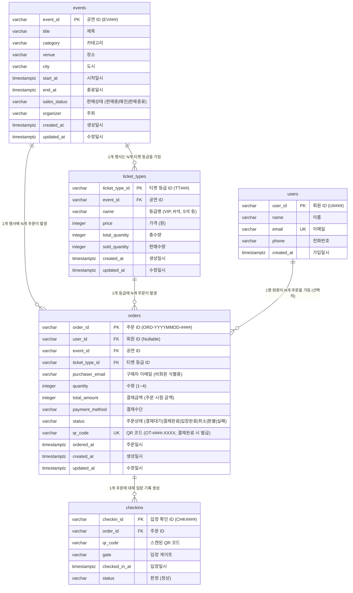

# 온티켓 데이터 설계서 (ERD)

- 버전: 0.1
- 상태: 초안
- 작성일: 2026-11-07
- 작성자: DBA
- 입력: `docs/PRD.md` (v1.1), `docs/화면기획서.md` (v1.0), `data/*.csv` (`events.csv`, `ticket_types.csv`, `users.csv`, `orders.csv`, `checkins.csv`)

| 버전 | 날짜 | 바꾼 것 | 결정자 |
|---|---|---|---|
| 0.1 | 2026-11-07 | PRD·화면기획서·CSV 기반 온티켓 데이터 설계서 초안 작성 (5개 테이블, 초과 판매 방지 CHECK 제약, 구매자 이메일 필수화, 결제대기·실패 상태 추가, 결정 기록 D1~D10 작성) | DBA |

---

## 1. 개체(테이블) 목록 및 개요

온티켓의 데이터 모델은 도메인 핵심 개체 5개로 구성된다.

| 테이블명 | 논리명 | 설명 | 관련 CSV |
|---|---|---|---|
| `events` | 공연(행사) | 공연/행사의 기본 정보와 판매 상태를 관리 | `data/events.csv` (12건) |
| `ticket_types` | 티켓 등급 | 공연별 좌석 등급, 가격, 총수량 및 판매수량을 관리 | `data/ticket_types.csv` (26건) |
| `users` | 회원 (사용자) | 기존 회원 정보 (1차 버전은 비회원제이나 레거시 호환 및 향후 확장을 위해 유지) | `data/users.csv` (50건) |
| `orders` | 주문 | 비회원 고객의 예매 주문, 결제 상태, QR 코드 발급 정보를 관리 | `data/orders.csv` (300건) |
| `checkins` | 입장 확인 기록 | 현장 게이트에서의 QR 티켓 스캔 및 입장 판정 이력을 기록 | `data/checkins.csv` (15건) |

---

## 2. 개체-관계 다이어그램 (ERD)



---

## 3. 테이블별 상세 설계

### 3.1 `events` (공연)

- 설명: 온티켓에서 예매 가능한 공연 및 행사의 정보
- 기준 자료: `data/events.csv`, `docs/PRD.md` R1·R24, `docs/화면기획서.md` S01·S02·S07·S08

| 컬럼명 | 논리명 | 타입 | Nullable | 기본값 | 제약조건 | 설명 |
|---|---|---|---|---|---|---|
| `event_id` | 공연 ID | `VARCHAR(32)` | NO | - | PRIMARY KEY | 공연 식별자 (예: `EV001`) |
| `title` | 제목 | `VARCHAR(255)` | NO | - | - | 공연명 (S01, S02, S07, S08 표시) |
| `category` | 카테고리 | `VARCHAR(50)` | NO | - | - | 콘서트, 뮤지컬, 세미나 등 |
| `venue` | 장소 | `VARCHAR(255)` | NO | - | - | 공연장 명칭 (예: 올림픽공원 올림픽홀) |
| `city` | 도시 | `VARCHAR(50)` | NO | - | - | 공연 지역 도시 (예: 서울) |
| `start_at` | 시작일시 | `TIMESTAMPTZ` | NO | - | - | 공연 시작 일시 |
| `end_at` | 종료일시 | `TIMESTAMPTZ` | NO | - | `CHECK (end_at >= start_at)` | 공연 종료 일시 |
| `sales_status` | 판매상태 | `VARCHAR(20)` | NO | `'판매중'` | `CHECK (sales_status IN ('판매중', '매진', '판매종료'))` | 공연의 예매 가능 상태 (CSV 한국어 유지) |
| `organizer` | 주최 | `VARCHAR(100)` | NO | `'(주)승승장구'` | - | 공연 주최사 |
| `created_at` | 생성일시 | `TIMESTAMPTZ` | NO | `NOW()` | - | 레코드 생성 일시 |
| `updated_at` | 수정일시 | `TIMESTAMPTZ` | NO | `NOW()` | - | 레코드 수정 일시 |

---

### 3.2 `ticket_types` (티켓 등급)

- 설명: 공연마다 등록되는 좌석 등급별 가격과 재고(총수량/판매수량) 정보
- 기준 자료: `data/ticket_types.csv`, `docs/PRD.md` R5·R6·R24, `docs/화면기획서.md` S02·S07·S08
- **파생값 제외**: `잔여수량`(`remaining_quantity`)은 `total_quantity - sold_quantity`로 계산되므로 DB에 저장하지 않는다.

| 컬럼명 | 논리명 | 타입 | Nullable | 기본값 | 제약조건 | 설명 |
|---|---|---|---|---|---|---|
| `ticket_type_id` | 티켓 등급 ID | `VARCHAR(32)` | NO | - | PRIMARY KEY | 등급 식별자 (예: `TT001`) |
| `event_id` | 공연 ID | `VARCHAR(32)` | NO | - | FOREIGN KEY (`events.event_id`) ON DELETE RESTRICT | 소속 공연 식별자 |
| `name` | 등급명 | `VARCHAR(50)` | NO | - | - | 좌석 등급 (VIP, R석, S석, 일반 등) |
| `price` | 가격 | `INTEGER` | NO | - | `CHECK (price >= 0)` | 1매당 티켓 가격 (원 단위) |
| `total_quantity` | 총수량 | `INTEGER` | NO | - | `CHECK (total_quantity >= 0)` | 해당 등급에 배정된 총 티켓 수량 |
| `sold_quantity` | 판매수량 | `INTEGER` | NO | `0` | `CHECK (sold_quantity >= 0)` | 결제 완료(또는 선점)된 누적 판매 수량 |
| `created_at` | 생성일시 | `TIMESTAMPTZ` | NO | `NOW()` | - | 레코드 생성 일시 |
| `updated_at` | 수정일시 | `TIMESTAMPTZ` | NO | `NOW()` | - | 레코드 수정 일시 |

> **테이블 레벨 제약조건 (초과 판매 원천 방지)**
> ```sql
> CONSTRAINT check_sold_not_exceed_total CHECK (sold_quantity <= total_quantity)
> ```
> *어떤 경우에도 판매수량이 총수량을 초과하여 저장될 수 없도록 DB가 강제한다.*

---

### 3.3 `users` (회원)

- 설명: 과거 회원 데이터 보관 및 향후 회원제 도입 대비용 테이블
- 기준 자료: `data/users.csv`
- 비고: 온티켓 1차 버전은 비회원 예매(PRD R20)이므로 새 예매 시 이 테이블을 거치지 않는다. 과거 `orders.csv` 300건의 `user_id`를 매핑하고 구매자 이메일을 역추적하는 원본으로 사용된다.

| 컬럼명 | 논리명 | 타입 | Nullable | 기본값 | 제약조건 | 설명 |
|---|---|---|---|---|---|---|
| `user_id` | 회원 ID | `VARCHAR(32)` | NO | - | PRIMARY KEY | 회원 식별자 (예: `U0001`) |
| `name` | 이름 | `VARCHAR(50)` | NO | - | - | 회원 실명 |
| `email` | 이메일 | `VARCHAR(255)` | NO | - | UNIQUE | 회원 이메일 주소 |
| `phone` | 전화번호 | `VARCHAR(20)` | YES | - | - | 연락처 |
| `created_at` | 가입일시 | `TIMESTAMPTZ` | NO | `NOW()` | - | 회원 가입 일시 |

---

### 3.4 `orders` (주문)

- 설명: 고객의 티켓 예매 주문, 결제 상태 및 QR 발급 정보
- 기준 자료: `data/orders.csv`, `docs/PRD.md` R1·R6·R7·R8·R20·R21·R22, `docs/화면기획서.md` S02·S03·S04·S05·S07
- **파생값/중복 제외**: CSV의 `등급` 컬럼은 `ticket_type_id` FK를 통해 `ticket_types.name`으로 조회할 수 있으므로 저장하지 않는다.
- **주문 시점 저장**: `total_amount`는 `가격 × 수량`으로 계산되는 값이지만, 추후 티켓 가격이 변경되어도 거래 당시의 영수 금액을 불변으로 보존해야 하므로 반드시 컬럼으로 저장한다.

| 컬럼명 | 논리명 | 타입 | Nullable | 기본값 | 제약조건 | 설명 |
|---|---|---|---|---|---|---|
| `order_id` | 주문 ID | `VARCHAR(32)` | NO | - | PRIMARY KEY | 주문 번호 (`ORD-YYYYMMDD-####`) |
| `user_id` | 회원 ID | `VARCHAR(32)` | YES | NULL | FOREIGN KEY (`users.user_id`) | 과거 주문 레거시 연동용 (비회원 주문 시 NULL) |
| `event_id` | 공연 ID | `VARCHAR(32)` | NO | - | FOREIGN KEY (`events.event_id`) | 주문 대상 공연 식별자 |
| `ticket_type_id` | 티켓 등급 ID | `VARCHAR(32)` | NO | - | FOREIGN KEY (`ticket_types.ticket_type_id`) | 주문 대상 등급 식별자 |
| `purchaser_email` | 구매자 이메일 | `VARCHAR(255)` | NO | - | - | **비회원 식별 및 티켓 조회(S05)의 핵심 키** |
| `quantity` | 수량 | `INTEGER` | NO | - | `CHECK (quantity >= 1 AND quantity <= 4)` | 1회 예매 가능 매수 (1~4장 제한 강제) |
| `total_amount` | 결제금액 | `INTEGER` | NO | - | `CHECK (total_amount >= 0)` | 주문 당시 확정된 실 결제 금액 |
| `payment_method` | 결제수단 | `VARCHAR(30)` | YES | NULL | - | 카드, 카카오페이, 토스페이, 네이버페이 등 (결제 승인 전 NULL 허용) |
| `status` | 주문 상태 | `VARCHAR(20)` | NO | `'결제대기'` | `CHECK (status IN ('결제대기', '결제완료', '입장완료', '취소', '환불', '실패'))` | 주문 진행 상태 (CSV 한국어 유지 + 결제대기·실패 추가) |
| `qr_code` | QR 코드 | `VARCHAR(50)` | YES | NULL | UNIQUE | 입장용 QR 코드 (`OT-####-XXXX`), 결제완료 시 서버 승인으로 1개 발급 |
| `ordered_at` | 주문일시 | `TIMESTAMPTZ` | NO | `NOW()` | - | 예매/주문 생성 일시 |
| `created_at` | 생성일시 | `TIMESTAMPTZ` | NO | `NOW()` | - | 레코드 생성 일시 |
| `updated_at` | 수정일시 | `TIMESTAMPTZ` | NO | `NOW()` | - | 레코드 수정 일시 |

---

### 3.5 `checkins` (입장 확인 기록)

- 설명: 현장 게이트에서 운영팀이 QR 코드를 스캔하여 입장시킨 이력
- 기준 자료: `data/checkins.csv`, `docs/PRD.md` R9, `docs/화면기획서.md` S09

| 컬럼명 | 논리명 | 타입 | Nullable | 기본값 | 제약조건 | 설명 |
|---|---|---|---|---|---|---|
| `checkin_id` | 입장 기록 ID | `VARCHAR(32)` | NO | - | PRIMARY KEY | 입장 확인 식별자 (예: `CHK0001`) |
| `order_id` | 주문 ID | `VARCHAR(32)` | NO | - | FOREIGN KEY (`orders.order_id`) | 입장 처리된 주문 번호 |
| `qr_code` | QR 코드 | `VARCHAR(50)` | NO | - | - | 스캔된 QR 코드 값 |
| `gate` | 게이트 | `VARCHAR(50)` | NO | - | - | 입장 게이트 (예: A게이트, B게이트, C게이트) |
| `checked_in_at` | 입장일시 | `TIMESTAMPTZ` | NO | `NOW()` | - | 입장 확인 처리 일시 |
| `status` | 판정 | `VARCHAR(20)` | NO | `'정상'` | `CHECK (status IN ('정상'))` | 입장 판정 결과 (CSV 한국어 유지) |

---

## 4. DB 수준 강제 제약조건 (다층 방어선)

코드가 실수로 뚫려도 DB가 데이터 무결성을 끝까지 지켜내도록 스키마 수준에서 다음 제약을 강제한다.

1. **초과 판매 차단 제약 (`ticket_types`)**:
   - `CONSTRAINT check_sold_not_exceed_total CHECK (sold_quantity <= total_quantity)`
   - 이유: 골목 라이브의 초과 판매 사고를 구조적으로 방지. API 서버의 사전 검증 로직과 별개로 DB 차원에서 판매수량이 총수량을 1장이라도 초과하는 저장을 원천 거절한다.
2. **QR 코드 유일성 제약 (`orders`)**:
   - `CONSTRAINT uk_orders_qr_code UNIQUE (qr_code)`
   - 이유: 서로 다른 주문에 중복된 QR 코드가 발급되어 한 장으로 두 사람이 입장하는 사고를 방지한다 (단, 결제 전 NULL은 허용).
3. **구매자 이메일 필수 제약 (`orders`)**:
   - `purchaser_email VARCHAR(255) NOT NULL`
   - 이유: 1차 버전에는 로그인이 없으므로, 구매자 이메일이 없는 주문은 티켓 조회(S05), 고객 안내, 환불 대응이 불가능하다.
4. **1회 주문 수량 제약 (`orders`)**:
   - `CONSTRAINT check_quantity_range CHECK (quantity >= 1 AND quantity <= 4)`
   - 이유: PRD R1 정책(1~4매)을 DB 레벨에서 강제하여 비정상 수량 주문(0매, 음수, 5매 이상) 유입을 방지한다.
5. **공연 기간 무결성 제약 (`events`)**:
   - `CONSTRAINT check_event_date_range CHECK (end_at >= start_at)`
   - 이유: 공연 종료일시가 시작일시보다 앞서는 잘못된 데이터 등록 방지.
6. **외래 키(FK) 참조 무결성 (`ON DELETE RESTRICT`)**:
   - 티켓 등급은 반드시 존재하는 공연을 참조해야 하며, 주문은 존재하는 공연과 등급을 참조해야 한다.
   - 주문이나 등급이 물려 있는 상태에서 부모 레코드(`events`, `ticket_types`)가 실수로 삭제되지 않도록 차단한다.

---

## 5. 상태값 정의 목록 (CSV 한국어 일치)

시스템 간의 어긋남을 없애기 위해 CSV 데이터에 기록된 한국어 텍스트를 그대로 표준 상태값으로 정의한다.

### 5.1 공연 판매상태 (`events.sales_status`)
- `판매중`: 고객이 목록(S01)에서 보고 상세(S02)에서 예매 가능한 상태
- `매진`: 운영팀이 지정했거나 모든 등급이 소진되어 예매가 불가능한 상태
- `판매종료`: 판매 기간이 만료되어 예매가 마감된 상태

### 5.2 주문 상태 (`orders.status`)
- `결제대기`: 예매 주문이 생성되었으나 결제 승인이 완료되지 않은 상태 (**화면기획서 S02→S03/S04 흐름 반영**)
- `결제완료`: 서버 승인을 거쳐 결제가 정상 완료되고 `qr_code`가 발급된 상태
- `입장완료`: 현장 게이트에서 QR 코드가 정상 확인되어 입장이 완료된 상태
- `취소`: 결제 전 또는 결제 직후 사용자가 취소한 상태
- `환불`: 결제 완료 후 금액이 환불된 상태 (입장 불가)
- `실패`: 결제사 거절, 한도 초과, 잔여수량 부족 등으로 승인이 실패한 상태 (**화면기획서 S04 반영**)

### 5.3 입장 판정 (`checkins.status`)
- `정상`: 결제완료 상태의 해당 공연 티켓으로 확인되어 입장이 승인됨

---

## 6. 질문 목록 (PRD 변경이 필요한 사항)

> DBA 판단 기준: 설계 세부 결정은 DBA가 판단하여 아래 '결정 기록'에 적었으며, 서비스 정책이나 PRD 본문을 직접 변경해야 하는 사항만 질문으로 남긴다.

1. **(PRD 질문) 주문 취소 및 환불 시 `ticket_types.sold_quantity` 재고 복구 정책 명시 여부**
   - **현황**: PRD R6 및 완료 기준에는 "결제가 완료되면 판매수량이 늘어난다"는 명시되어 있으나, 고객이 주문을 '취소'하거나 운영팀이 '환불'했을 때 `sold_quantity`를 즉시 차감하여 잔여석을 반환해야 하는지에 대한 AC가 PRD에 없다.
   - **DBA 권고**: 데이터 무결성 관점에서 취소/환불 시 `sold_quantity = sold_quantity - quantity`로 복구하는 것이 도메인 원칙에 맞다. 이 정책을 차기 PRD 갱신 시 완료 기준으로 추가할 것인지 결정이 필요하다. (결정자: PM / 개발 리더)

---

## 7. 결정 기록 (Decision Log)

DBA가 설계를 진행하며 내린 핵심 결정들과 그 이유는 다음과 같다.

- **D1. 핵심 엔티티 5개 확정 (`events`, `ticket_types`, `users`, `orders`, `checkins`)**
  - 이유: 도메인의 본질(공연-등급-주문-입장)과 기존 CSV 5종의 데이터 구조와 정확히 일치한다. PRD 범위 제외에 명시된 쿠폰, 마일리지, 리뷰 등 불필요한 테이블은 배제했다.
- **D2. 기존 ID 체계(포맷) 유지 (`EV###`, `TT###`, `ORD-YYYYMMDD-####`, `CHK####`, `U####`)**
  - 이유: 기존 CSV 표본 데이터와의 100% 호환성을 유지하고, PRD 및 화면기획서의 주문번호/QR코드 포맷 요구사항(`ORD-YYYYMMDD-####`, `OT-####-XXXX`)을 지원하기 위해 문자열 기본키(`VARCHAR`)를 유지한다.
- **D3. 파생값 `잔여수량` DB 컬럼 저장 배제**
  - 이유: `data/ticket_types.csv`에는 `잔여수량` 컬럼이 존재하지만, `잔여수량 = 총수량 - 판매수량`으로 언제나 정확히 계산된다. 이를 컬럼으로 이중 관리하면 동시성 업데이트 시 판매수량과 잔여수량이 어긋나는 불일치 버그가 발생하므로 DB 컬럼에서 배제하고 뷰 또는 API 서버 계산값으로 처리한다.
- **D4. 주문 시점 `결제금액(total_amount)` 저장 결정**
  - 이유: `결제금액` 역시 `티켓단가 × 수량`으로 계산 가능해 보이지만, 티켓 가격이 나중에 할인되거나 인상되더라도 과거 고객이 실제로 지불한 거래 금액은 변하지 않아야 하는 원천 증빙(회계적 불변 기록)이므로 주문 테이블에 물리 컬럼으로 반드시 저장한다.
- **D5. 비회원 예매를 위한 `purchaser_email` 필수화 및 `user_id` Nullable 처리**
  - 이유: PRD R20(로그인 없는 예매)과 화면기획서 S05(주문번호+이메일 티켓 조회)를 지원하기 위해 `orders`에 `purchaser_email`을 필수(`NOT NULL`)로 둔다. 기존 CSV 300건의 주문 데이터는 `users.csv`의 `user_id`를 역추적하여 구매자 이메일을 100% 채운다. 향후 회원제 도입 시를 대비해 `user_id` 외래키는 Nullable로 남겨둔다.
- **D6. 주문 상태값에 `결제대기` 및 `실패` 추가**
  - 이유: CSV는 이미 성사된 과거 주문 기록이어서 `결제완료`, `입장완료`, `취소`, `환불`만 존재한다. 그러나 화면기획서의 실제 화면 흐름(S02 예매 → S03 완료 / S04 실패)을 지원하려면 주문 생성 직후 결제 승인 전까지 머무는 `결제대기` 상태와, 결제사 승인 거절 시 남겨야 할 `실패` 상태가 필수적이므로 상태값에 추가했다.
- **D7. 상태값의 한국어 글자 그대로 유지**
  - 이유: PRD와 CSV에 명시된 `판매중`, `매진`, `판매종료`, `결제완료` 등의 한국어 텍스트를 영문 enum으로 임의 번역하면 향후 API 명세 및 화면 구현 단계에서 번역 불일치로 인한 오류가 발생하므로 글자 그대로 유지한다.
- **D8. 판매수량 초과 방지 `CHECK (sold_quantity <= total_quantity)` 제약조건 적용**
  - 이유: 사용자의 명시적 지시("판매수량이 총수량을 넘는 일은 DB가 막아야 해") 및 온티켓 제1목표(초과 판매 0건)를 달성하기 위해, 백엔드 애플리케이션 검증에만 의존하지 않고 DB의 최후 방어선으로 CHECK 제약을 강제했다.
- **D9. `qr_code` 발급 시점 및 UNIQUE 제약**
  - 이유: PRD R22에 따라 서버가 결제를 승인하여 `결제완료` 상태가 될 때만 `qr_code`가 발급된다. 따라서 주문 생성(`결제대기`) 시점에는 NULL을 허용하되, 발급된 QR 코드는 다른 주문과 절대 중복될 수 없도록 `UNIQUE` 제약을 부여한다.
- **D10. 주문 시 중복 등급명 컬럼 배제**
  - 이유: `data/orders.csv`에 있는 `등급` 컬럼(VIP, R석 등)은 `ticket_type_id` 외래키를 통해 부모 테이블(`ticket_types.name`)에서 즉시 조회 가능하므로, 같은 사실의 중복 저장을 막기 위해 `orders` 테이블에서 제외했다.
